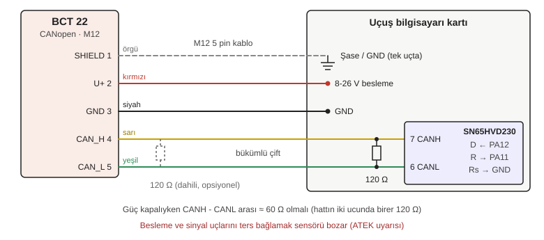

# BCT 22 CANopen Okuyucu

CANopen çıkışlı ATEK BCT 22 basınç sensörünü CAN hattından okuyan STM32 HAL modülü ve kurulum notları.

Sensör doğrudan CAN hattına bağlanır, araya arayüz kartı girmez. Bu modül hattaki MCU'da (örneğin uçuş bilgisayarında) çalışır ve şunları yapar:

- sensörü başlatır (NMT start),
- gelen ölçümleri (PDO) bar'a çevirir,
- sensör susarsa ya da yeniden başlarsa bunu fark eder ve sensörü tekrar çalıştırır,
- sensörün gönderdiği hata mesajlarını (EMCY) saklar.

İlk kurulum için gereken SDO ve LSS araçları da modülün içindedir.

Sensöre ait değerler ATEK'in BCT 22 teknik dokümanından (DS-BCT.001 Rev 5) alınmıştır.

> 4-20 mA versiyonu için yazılan `pressure_node` modülü bu sensörde kullanılmaz.

## İçindekiler

1. Dosyalar
2. Sensörün CANopen özellikleri
   - 2.1 4-20 mA versiyonuyla karşılaştırma
3. CANopen'a kısa giriş
   - 3.1 CAN ve CANopen
   - 3.2 Node-ID ve COB-ID
   - 3.3 NMT: sensörün durumları
   - 3.4 PDO: ölçüm verisi
   - 3.5 SDO ve nesne sözlüğü
   - 3.6 Heartbeat ve EMCY
   - 3.7 LSS: node-ID ve bit hızı ayarı
4. Elektriksel bağlantı
5. Bit hızı seçimi
6. Ölçüm hızı
7. Kodsal altyapı
   - 7.1 Tasarım kararları
   - 7.2 CubeMX ayarları
   - 7.3 Ayarlar (canopen_pressure.h)
   - 7.4 Kullanım: CP_Init, CP_Process, CP_Get
   - 7.5 Modülün çalışma mantığı
   - 7.6 Kurulum araçları: SDO ve LSS
8. İlk kurulum (tezgahta, bir kez)
9. Ekip için entegrasyon kuralları
10. Test adımları
11. Sorun giderme

---

## 1. Dosyalar

```
canopen_pressure/
├── README.md
├── Inc/canopen_pressure.h    ayarlar, tipler, fonksiyonlar
├── Src/canopen_pressure.c    NMT, PDO, heartbeat, EMCY, SDO, LSS
├── docs/baglanti.svg         kablo bağlantı şeması
├── ornekler/kurulum_main.c   tezgah kurulumu, sensör başına bir kez
└── ornekler/ucus_main.c      uçuş kodu
```

`ornekler` klasöründeki dosyalar projeye eklenmez; içlerindeki parçalar main.c'deki aynı isimli USER CODE bloklarına kopyalanır. İkisi de `main()` içerdiği için klasör `Core/Src` altına konursa proje derlenmez.

`canopen_pressure.h` projenin `Core/Inc`, `canopen_pressure.c` ise `Core/Src` klasörüne kopyalanır. Bu iki klasör CubeIDE projesinde zaten derleme ayarlarına ekli olduğu için başka bir ayar gerekmez. CubeMX yeniden kod üretse de bu dosyalara dokunmaz.

---

## 2. Sensörün CANopen özellikleri

| Özellik | Değer |
|---|---|
| Haberleşme profili | CiA 301 |
| Cihaz profili | CiA 404 (ölçüm cihazları) |
| Node-ID | 1 - 127, LSS veya SDO ile ayarlanır. Fabrika ayarı: **1** |
| Bit hızı | 10 kbit/s - 1 Mbit/s. Fabrika ayarı: **125 kbit/s** |
| PDO veri hızı | 1000 ms |
| PDO | 4 adet TPDO (sensörden gönderim) |
| PDO modları | Olay/zaman tetiklemeli, senkron/asenkron |
| SDO | 1 sunucu |
| Hata kontrolü | Heartbeat, EMCY |
| Ölçüm nesnesi | 0x6130 / 0x7130 / 0x8130 / 0x9130 |
| Sonlandırma direnci | Opsiyonel |
| Besleme | 8 - 26 V DC |
| Çalışma akımı | En fazla 30 mA |
| Cevap süresi (%10 - %90) | 25 ms standart; 5 veya 125 ms opsiyonel (1 ms opsiyonu sadece akım çıkışlı modellerde) |
| Doğruluk | ±%0.5 T.S. (25 °C), ±%1 T.S. (0 ... +70 °C), ±%2 T.S. (-40 ... +85 °C) |
| Çözünürlük | 12 bit |
| Ölçüm şekli | Göreceli (relative); mutlak (absolute) siparişte belirtilirse |
| Ters polarite koruması | Sadece besleme ucunda |
| Çalışma sıcaklığı | -40 ... +85 °C |
| Konnektör | M12x1, 5 pin (sipariş kodu S13) |

Kutudan çıktığı haliyle sensör node-ID 1 ve 125 kbit/s ile çalışır. Dokümandaki 1000 ms'lik PDO hızı büyük ihtimalle fabrika ayarıdır, yani sensör saniyede yalnızca bir ölçüm gönderir. Bu ayarlar ilk kurulumda okunup değiştirilir (bkz. 8).

Dikkat: Analog versiyonun beslemesi 8-32 V idi, CANopen versiyonunun üst sınırı **26 V**'tur.

### 2.1 4-20 mA versiyonuyla karşılaştırma

| | 4-20 mA + arayüz kartı (`pressure_node`) | CANopen (bu modül) |
|---|---|---|
| Ek donanım | MCU, şönt, RC, kelepçe, transceiver | Yok |
| Ölçüm hatası | Sensör + şönt + VREF + ADC | Sadece sensör |
| Çözünürlük | Sensör 12 bit, ardından ADC 12 bit | Sensör 12 bit |
| Arıza tespiti | Bizim yazdığımız durum bitleri | Standart heartbeat ve EMCY |
| Cevap süresi | 25 ms; 1 ms opsiyonu var | 25 ms; 1 ms opsiyonu yok |
| Besleme | 8-32 V (şönt yüzünden pratikte 12-32 V) | 8-26 V |
| Kablolama | Sensörden karta 2 tel, karttan hatta 4 tel | Sensörden hatta doğrudan |
| Yazılım | Arayüz kartının firmware'i | Hattaki MCU'da küçük bir okuyucu |

**Sonuç:** Tank, hat ve regülatör basınçları gibi ölçümler için CANopen versiyonu daha iyidir: bir kart, bir analog hata zinciri ve ayrı bir firmware ortadan kalkar. Tek istisna çok hızlı değişen basınçlardır (örneğin ateşleme anında yanma odası). 25 ms'lik cevap süresi bu değişimleri yumuşatır. 1 ms gerekiyorsa dokümana göre tek yol 1 ms opsiyonlu 4-20 mA versiyonu ve `pressure_node` modülüdür.

---

## 3. CANopen'a kısa giriş

### 3.1 CAN ve CANopen

CAN, bitlerin hatta nasıl taşınacağını, aynı anda gönderen iki düğümün çakışmasının nasıl çözüleceğini ve hataların nasıl yakalanacağını tanımlar. Ama bir çerçevenin içindeki 8 baytın ne anlama geldiğini söylemez.

CANopen bunun üstüne kurulan bir protokoldür. Şunları standartlaştırır:

- hangi ID'nin ne taşıdığı,
- cihazların nasıl başlatılıp durdurulacağı,
- ayarların nasıl okunup yazılacağı,
- hataların nasıl bildirileceği.

Böylece farklı üreticilerin cihazları aynı kurallarla konuşur. Bir benzetmeyle: CAN posta servisidir, CANopen ise mektupların hangi formatta yazılacağını belirleyen ortak dildir.

### 3.2 Node-ID ve COB-ID

Hattaki her CANopen cihazının 1 ile 127 arasında bir numarası vardır: **node-ID**. CAN çerçevesinin 11 bitlik ID'sine CANopen'da **COB-ID** denir ve iki parçadan oluşur:

```
COB-ID (11 bit) = fonksiyon kodu (üst 4 bit) + node-ID (alt 7 bit)
```

Fonksiyon kodu mesajın türünü, node-ID ise mesajı gönderen ya da alan cihazı gösterir. Node-ID'si 1 olan sensörün kullandığı ID'ler:

| Mesaj | Formül | Node 1 için | Yön |
|---|---|---|---|
| NMT komutu | 0x000 | 0x000 | Biz → sensör |
| EMCY (hata) | 0x080 + ID | 0x081 | Sensör → biz |
| TPDO1 (ölçüm) | 0x180 + ID | 0x181 | Sensör → biz |
| TPDO2 / 3 / 4 | 0x280 / 0x380 / 0x480 + ID | 0x281 / 0x381 / 0x481 | Sensör → biz |
| SDO cevabı | 0x580 + ID | 0x581 | Sensör → biz |
| SDO isteği | 0x600 + ID | 0x601 | Biz → sensör |
| Heartbeat | 0x700 + ID | 0x701 | Sensör → biz |
| LSS | sabit | 0x7E5 (biz → sensör), 0x7E4 (sensör → biz) | İki yön |

CAN'de düşük ID önceliklidir. Bu yüzden CANopen'da NMT (0x000) en öncelikli, heartbeat en az öncelikli mesajdır. Aynı türdeki mesajlarda node-ID'si küçük olan cihaz önce gider.

### 3.3 NMT: sensörün durumları

Her CANopen cihazının bir durum makinesi vardır ve bu makineyi NMT (Network Management) komutları yönetir:

```
       güç verildi
            |
            v
   +-----------------+
   |     Boot-up     |   0x700+ID ile tek bayt 0x00 gönderir
   +-----------------+
            |
            v
   +-----------------+
   | Pre-operational |   SDO çalışır, ölçüm (PDO) GÖNDERİLMEZ
   +-----------------+
        |        ^
  start |        | pre-op
 (0x01) v        | (0x80)
   +-----------------+
   |   Operational   |   SDO ve PDO çalışır, ölçümler akar
   +-----------------+
```

Ayrıca bir de Stopped durumu vardır. Cihaz Stop komutuyla (0x02) bu duruma geçer ve yalnızca NMT komutlarını dinler.

**En önemli nokta:** sensör açıldığında Pre-operational durumda başlar ve biri start komutu göndermeden ölçüm göndermez. Hatta bunu yapan kimse yoksa sensör sessiz kalır. Bu modül start komutunu kendisi gönderir.

Rokette bu iki kez önemlidir. Bir güç dalgalanmasında sensör yeniden başlarsa yine Pre-operational'a düşer ve susar. Modül bunu fark edip sensörü tekrar başlatır (bkz. 7.5).

NMT çerçevesi: ID 0x000, 2 bayt.

| Bayt 0 (komut) | Anlamı |
|---|---|
| 0x01 | Start (Operational'a geç) |
| 0x02 | Stop |
| 0x80 | Pre-operational'a geç |
| 0x81 | Reset node (cihazı yeniden başlat) |
| 0x82 | Reset communication |

Bayt 1 hedef node-ID'dir; 0 yazılırsa komut hattaki tüm cihazlara gider.

Cihazın durumu heartbeat mesajının tek baytında gelir:

| Değer | Durum |
|---|---|
| 0x00 | Boot-up (yeni açıldı) |
| 0x04 | Stopped |
| 0x05 | Operational |
| 0x7F | Pre-operational |

### 3.4 PDO: ölçüm verisi

PDO (Process Data Object), ölçüm verisini taşıyan çerçevedir. Sensör PDO'yu kendiliğinden, istek beklemeden gönderir. Hızlı veri için tasarlanmıştır: 8 baytın tamamı veridir, araya başlık girmez.

PDO'nun içinde hangi verinin hangi baytlarda olduğunu **eşleme (mapping)** belirler. TPDO1'in eşlemesi 0x1A00 nesnesindedir. Her eşleme kaydı 32 bittir ve üç bilgi taşır:

```
0x1A00:01 = 0x61300120
              ^^^^ ^^ ^^
              |    |  +-- uzunluk: 0x20 = 32 bit
              |    +----- alt indeks: 0x01
              +---------- nesne: 0x6130
```

Bu örnek "TPDO1'in ilk 4 baytında 0x6130:01 nesnesi var" demektir.

ATEK dokümanına göre ölçüm 0x6130, 0x7130, 0x8130 veya 0x9130 nesnelerinden birindedir. CiA 404 profilinde bu nesneler genellikle aynı ölçümün farklı veri tipleridir:

| Nesne | Veri tipi | Uzunluk | `CP_PDO_TYPE` |
|---|---|---|---|
| 0x6130 | REAL32 (float) | 32 bit | `CP_TYPE_REAL32` |
| 0x7130 | INTEGER16 | 16 bit | `CP_TYPE_INT16` |
| 0x8130 | INTEGER24 | 24 bit | `CP_TYPE_INT24` |
| 0x9130 | INTEGER32 | 32 bit | `CP_TYPE_INT32` |

Hangisinin kullanıldığı tahmin edilmez, sensörden okunur (bkz. 8, 2. adım). Tam sayı tiplerinde değerin kaç ondalık basamak taşıdığı ayrı bir ayardır; CiA 404'te bu genellikle 0x6132 nesnesindedir. Örneğin değer 12345 ve ondalık basamak 3 ise ölçüm 12.345'tir. CANopen'da tüm çok baytlı değerler little-endian'dır: düşük bayt önce gelir.

PDO'nun **ne zaman** gönderileceğini iki ayar belirler:

| Nesne | Anlamı |
|---|---|
| 0x1800:02 | Gönderim tipi. 254 veya 255: olay/zaman tetiklemeli. 1-240: SYNC mesajına bağlı |
| 0x1800:05 | Event timer (ms). Gönderim tipi 254/255 iken PDO bu periyotla gönderilir |

Bu modül 254/255 (zaman tetiklemeli) çalışmayı varsayar; SYNC kullanmaz.

### 3.5 SDO ve nesne sözlüğü

Her CANopen cihazının bir **nesne sözlüğü** vardır: cihazın tüm ayarlarının ve değerlerinin bulunduğu bir tablo. Her kayda bir **index** (16 bit) ve **alt indeks** (8 bit) ile ulaşılır. Örneğin heartbeat periyodu 0x1017:00'dadır.

SDO (Service Data Object) bu tablodaki tek bir kaydı okumak ya da yazmak için kullanılan istek-cevap mekanizmasıdır. Ayar içindir, hızlı veri için değil. 4 bayta kadar veri tek çerçevede taşınır (hızlı aktarım). Bu modül sadece bunu destekler; ayar için yeterlidir.

```
bayt:   0        1-2           3             4-7
      komut   index (LE)   alt indeks   veri (LE)
```

| İşlem | Bayt 0 |
|---|---|
| Okuma isteği | 0x40 |
| Okuma cevabı (1 / 2 / 3 / 4 bayt) | 0x4F / 0x4B / 0x47 / 0x43 |
| Yazma isteği (1 / 2 / 3 / 4 bayt) | 0x2F / 0x2B / 0x27 / 0x23 |
| Yazma onayı | 0x60 |
| Hata (abort) | 0x80; bayt 4-7 hata kodu |

Örnek, node 1'de heartbeat'i 100 ms yapmak:

```
istek  (ID 0x601):  2B 17 10 00 64 00 00 00     yaz, 2 bayt, 0x1017:00 = 100
cevap  (ID 0x581):  60 17 10 00 00 00 00 00     tamam
```

Bu proje için önemli nesneler:

| Nesne | İçerik | Not |
|---|---|---|
| 0x1000 | Cihaz tipi | Alt 16 bit cihaz profilidir: 404 = 0x0194 |
| 0x1010:01 | Ayarları kalıcı kaydet | "save" yazılır: 0x65766173 |
| 0x1011:01 | Fabrika ayarlarına dön | "load" yazılır: 0x64616F6C |
| 0x1017 | Heartbeat periyodu (ms) | 0 = kapalı |
| 0x1018 | Kimlik: üretici, ürün kodu, revizyon, seri no | Alt indeks 1-4 |
| 0x1800:02 | TPDO1 gönderim tipi | 3.4 |
| 0x1800:05 | TPDO1 event timer (ms) | 3.4 |
| 0x1A00 | TPDO1 eşlemesi | :00 nesne sayısı, :01... nesneler |
| 0x6130 ... 0x9130 | Ölçüm (CiA 404) | 3.4 |

Sık görülen abort kodları:

| Kod | Anlamı |
|---|---|
| 0x05040000 | SDO zaman aşımı |
| 0x06010002 | Salt okunur nesneye yazma denendi |
| 0x06020000 | Nesne yok |
| 0x06070010 | Veri tipi veya uzunluk uyuşmuyor |
| 0x06090011 | Alt indeks yok |
| 0x06090030 | Değer izin verilen aralığın dışında |
| 0x08000020 | Veri aktarılamıyor veya kaydedilemiyor |
| 0x08000022 | Cihazın şu anki durumunda yapılamaz |

### 3.6 Heartbeat ve EMCY

**Heartbeat:** Sensörün periyodik olarak gönderdiği tek baytlık "yaşıyorum" mesajıdır (ID 0x700 + node-ID). İçinde sensörün NMT durumu vardır (bkz. 3.3). Periyodu 0x1017 nesnesiyle ayarlanır, 0 ise kapalıdır.

Açılıştaki boot-up mesajı aslında özel bir heartbeat'tir (değeri 0x00). Heartbeat kapalı olsa bile sensör her açılışta bunu gönderir. Modül sensörün yeniden başladığını bu mesajdan anlar.

**EMCY:** Sensör bir hata tespit ettiğinde gönderdiği 8 baytlık mesajdır (ID 0x080 + node-ID):

| Bayt | İçerik |
|---|---|
| 0-1 | Hata kodu (little-endian) |
| 2 | Hata kaydı (0x1001 nesnesinin değeri) |
| 3-7 | Üreticiye özel |

Hata kodunun üst kısmı hatanın türünü gösterir (CiA 301):

| Kod | Anlamı |
|---|---|
| 0x0000 | Hata yok / hata temizlendi |
| 0x1000 | Genel hata |
| 0x2000 | Akım |
| 0x3000 | Gerilim |
| 0x4000 | Sıcaklık |
| 0x5000 | Cihaz donanımı |
| 0x6000 | Cihaz yazılımı |
| 0x8000 | İzleme (0x81xx: haberleşme) |
| 0xFF00 | Cihaza özel |

Sensöre özel kodların anlamı ATEK'ten öğrenilmelidir.

### 3.7 LSS: node-ID ve bit hızı ayarı

LSS (Layer Setting Services, CiA 305) node-ID'yi ve bit hızını hat üzerinden değiştirmeyi sağlar. Node-ID'ye bağlı olmayan sabit ID'ler kullanır: 0x7E5 (biz → sensör) ve 0x7E4 (sensör → biz).

**Dikkat:** "Global durum değiştir" komutu hattaki **tüm** LSS cihazlarını ayar moduna alır. Hatta birden fazla sensör varken node-ID değiştirilirse hepsi aynı ID'yi alır. LSS işlemi hatta **tek sensör** varken yapılmalıdır. Birden fazla sensör sırayla, tek tek ayarlanır.

| İşlem | Bayt 0 | Diğer baytlar | Cevap |
|---|---|---|---|
| Global durum değiştir | 0x04 | Bayt 1: 1 = ayar modu, 0 = bekleme | Yok |
| Node-ID ayarla | 0x11 | Bayt 1: yeni ID | Var |
| Bit hızı ayarla | 0x13 | Bayt 1: 0 (standart tablo), bayt 2: tablo sırası | Var |
| Kaydet | 0x17 | - | Var |

Cevapta (0x7E4) bayt 0 aynı komuttur, bayt 1 hata kodudur; 0 başarılı demektir.

Bit hızı tablo sırası:

| Sıra | Bit hızı |
|---|---|
| 0 | 1 Mbit/s |
| 1 | 800 kbit/s |
| 2 | 500 kbit/s |
| 3 | 250 kbit/s |
| 4 | 125 kbit/s |
| 6 | 50 kbit/s |
| 7 | 20 kbit/s |
| 8 | 10 kbit/s |

Yeni node-ID ve bit hızı, kaydettikten sonra sensörün gücü kesilip tekrar verilince geçerli olur.

---

## 4. Elektriksel bağlantı



**M12 5 pin bağlantısı:**

| M12 pin | Sinyal | Kablo rengi | Bağlantı |
|---|---|---|---|
| 1 | CAN_SHIELD | Örgü | Tek uçta topraklanır (genelde kart tarafı) |
| 2 | U+ (8-26 V) | Kırmızı | Besleme |
| 3 | GND (0 V) | Siyah | Ortak toprak |
| 4 | CAN_H | Sarı | SN65HVD230 pin 7 (CANH) |
| 5 | CAN_L | Yeşil | SN65HVD230 pin 6 (CANL) |

ATEK uyarısı: besleme ve sinyal uçlarını ters bağlamak sensörü bozar. Ters polarite koruması sadece besleme ucundadır. İlk enerji öncesinde bağlantı ölçü aletiyle kontrol edilmelidir.

Dokümandaki "Örnek Bağlantılar" çizimleri sadece analog modeller içindir; CANopen için örnek çizim yoktur. CANopen bağlantısı dokümanın 5. sayfasındaki "CANopen Çıkış İçin Elektriksel Bağlantı" tablosunda (M12 / 5 pin, S13) verilir. Yukarıdaki tablo ve şema o tabloya göre hazırlanmıştır. "Mekanik Bağlantı Seçenekleri" bölümü ise basınç bağlantısının dişini (G1/4, NPT1/4 gibi) anlatır, elektriksel bağlantıyla ilgisi yoktur.

Sipariş kodunda çıkış sinyali **C** (CANopen), elektriksel bağlantı **S13** (M12x1 5 pin) olmalıdır. Örnek: `BCT 22 10Bar C G1/4 S13`. Sensör etiketindeki kod bununla karşılaştırılmalıdır.

**Besleme:** 8-26 V, sensör başına en fazla 30 mA. Bu versiyonda şönt olmadığı için besleme koşulu analog versiyondan daha rahattır:

| Kaynak | Dolu | Boş (~3.3 V/hücre) | Uygun mu? |
|---|---|---|---|
| 3S LiPo | 12.6 V | ~9.9 V | Evet |
| 4S LiPo | 16.8 V | ~13.2 V | Evet |
| 6S LiPo | 25.2 V | ~19.8 V | Önerilmez: dolu pil 26 V sınırına çok yakın |
| Regüleli 12 V | 12 V | 12 V | Evet |

**Sonlandırma:** Hattın iki fiziksel ucunda birer 120 Ω olmalıdır. Sensörde dahili sonlandırma direnci opsiyoneldir; siparişte olup olmadığı öğrenilmelidir. Sensör hattın ucundaysa ve dahili direnç yoksa o uca harici 120 Ω konur. Kontrol için güç kapalıyken CANH ile CANL arası ölçülür:

| Ölçülen | Anlamı |
|---|---|
| ~60 Ω | Doğru (iki adet 120 Ω paralel) |
| ~120 Ω | Bir uç eksik |
| ~40 Ω | Fazladan bir sonlandırma var |

**Uçuş bilgisayarı tarafı (SN65HVD230):**

| Pin | Ad | Bağlantı |
|---|---|---|
| 1 | D | STM32 CAN1_TX (PA12) |
| 2 | GND | GND |
| 3 | VCC | 3.3 V, pine yakın 100 nF dekuplaj |
| 4 | R | STM32 CAN1_RX (PA11) |
| 5 | Vref | Boş bırakılabilir |
| 6 | CANL | Hat |
| 7 | CANH | Hat |
| 8 | Rs | GND (yüksek hız modu). VCC'ye bağlanırsa transceiver gönderim yapmaz |

**Elektrik tarafında yapılacaklar** (eleman ve kablo seçimi elektrik ekibine aittir):

- [ ] Sensör beslemesi 8-26 V aralığında olacak.
- [ ] M12 bağlantısı yukarıdaki tabloya göre yapılacak, ilk enerji öncesinde kontrol edilecek.
- [ ] Sensörde dahili sonlandırma olup olmadığı öğrenilecek.
- [ ] Hattın iki ucunda 120 Ω olacak; güç kapalıyken CANH - CANL ≈ 60 Ω ölçülecek.
- [ ] Bükümlü çift kullanılacak, GND hattı taşınacak, ekran (shield) tek uçta topraklanacak.
- [ ] Sensör hattın ucunda değilse hatta bağlandığı saplama (stub) kısa tutulacak.
- [ ] Uçuş bilgisayarı kartında SN65HVD230 yukarıdaki tabloya göre bağlanacak.
- [ ] Uçuş bilgisayarında HSE kristal olacak (CAN için şart).
- [ ] IP67 için baskılı M12 soketli kablo kullanılacak.

**Mekanik notlar:**

- CANopen model yaklaşık 78 mm boyunda, gövde çapı 23 mm, konnektör M12x1.
- Montaj torku 15-20 Nm. Anahtar ölçüsü 22 mm (G1/2 bağlantılı modelde 24 mm).
- Montajda ürün soketten tutularak çevrilmemelidir.
- Aşırı basınç dayanımı: 700 mbar'a kadar olan modellerde tam skalanın %300'ü, 250 bar'ın altındakilerde %200'ü, 250 bar ve üstünde %150'si. Bu sınırların üstünde birkaç kez (dokümana göre 3-5) basınç gören sensör hasar görebilir. Ölçüm aralığı ani basınç sıçramaları hesaba katılarak seçilmelidir.
- Su ile yapılan testlerde (örneğin soğuk akış) sensörle gelen M5 valfi çıkarılmamalıdır; ani basınç darbelerine karşı korur.

---

## 5. Bit hızı seçimi

Hattaki **tüm** düğümler aynı bit hızında çalışmak zorundadır. Farklı hızdaki tek bir düğüm, hata çerçeveleriyle tüm hattı kullanılamaz hale getirir. Ayarlanmamış bir sensör, farklı hızda çalışan bir hatta asla takılmamalıdır.

İki seçenek var:

| | A: Hat 125 kbit/s | B: Hat 500 kbit/s |
|---|---|---|
| Sensörde ayar | Gerekmez (fabrika ayarı) | LSS ile bir kez 500 kbit/s yapılır |
| 100 Hz'de sensörün hat yükü | %6 - %11 | %1.6 - %2.7 |
| Kablo uzunluğuna tolerans | Daha yüksek | Daha düşük |

Karar ekibindir. Modül varsayılan olarak 125 kbit/s ile gelir, böylece sensör kutudan çıktığı gibi çalışır. B seçilirse önce 8. bölümdeki 5. adım (LSS) yapılır, sonra CubeMX ve `CP_CAN_BITRATE` güncellenir.

**CubeMX CAN1 bit zamanlaması:**

| Bit hızı | Prescaler | BS1 (APB1 = 42 MHz) | BS1 (APB1 = 45 MHz) | BS2 | SJW |
|---|---|---|---|---|---|
| 125 kbit/s | 24 | 11 Times | 12 Times | 2 Times | 1 Time |
| 250 kbit/s | 12 | 11 Times | 12 Times | 2 Times | 1 Time |
| 500 kbit/s | 6 | 11 Times | 12 Times | 2 Times | 1 Time |
| 1 Mbit/s | 3 | 11 Times | 12 Times | 2 Times | 1 Time |

APB1 = 42 MHz, SYSCLK 168 MHz demektir (örneğin F407); bir bit 1 + 11 + 2 = 14 zaman dilimidir ve örnekleme noktası %85.7'dir. APB1 = 45 MHz, SYSCLK 180 MHz demektir (örneğin F429, F446); bir bit 1 + 12 + 2 = 15 zaman dilimidir ve örnekleme noktası %86.7'dir.

```
bit hızı          = f_APB1 / (Prescaler × (1 + BS1 + BS2))
örnekleme noktası = (1 + BS1) / (1 + BS1 + BS2)
```

---

## 6. Ölçüm hızı

Sensörün cevap süresi standart modelde 25 ms'dir: basınç aniden değişirse sensörün çıkışı bu değişimin %10'undan %90'ına 25 ms'de gelir. Sensör bundan hızlı değişimleri zaten gösteremez. Daha hızlı örneklemek yeni bilgi getirmez, aynı değeri tekrar tekrar gönderir.

Kaba bir kural: bant genişliği ≈ 0.35 / yükselme süresi = 0.35 / 25 ms ≈ 14 Hz. 100 Hz örnekleme bunun yaklaşık 7 katıdır ve sensörün gösterebildiği her şeyi yakalar.

| Durum | Event timer (0x1800:05) | `CP_PDO_PERIOD_MS` | Ne zaman |
|---|---|---|---|
| Fabrika | 1000 ms (1 Hz) | - | Kullanılmaz, çok yavaş |
| Normal (önerilen) | 10 ms (100 Hz) | 10 | Standart 25 ms'lik sensör |
| Hızlı | 1 ms (1 kHz) | 1 | Bu sensörde anlamsız: 1 ms opsiyonu CANopen modelde yok |

**Hat yükü:** PDO'nun uzunluğu eşlemeye bağlıdır. Ölçüm tek başına 4 bayt (REAL32) olabileceği gibi, eşlemede başka nesneler de varsa 8 bayt olabilir. Çerçeve uzunluğu bit doldurma (stuffing) ile birlikte:

| PDO verisi | Çerçeve (bit) | 125 kbit/s'de süre | 500 kbit/s'de süre |
|---|---|---|---|
| 4 bayt | 79 - 95 | 632 - 760 µs | 158 - 190 µs |
| 8 bayt | 111 - 135 | 888 - 1080 µs | 222 - 270 µs |

| | 125 kbit/s | 500 kbit/s |
|---|---|---|
| 100 Hz, 4 bayt | %6.3 - %7.6 | %1.6 - %1.9 |
| 100 Hz, 8 bayt | %8.9 - %10.8 | %2.2 - %2.7 |

**Çözünürlük:** Sensör 12 bit çözünürlüklüdür. Okunan değer tam skalanın 1/4096'sı kadar adımlarla değişir: 10 bar'lık sensörde ~2.4 mbar, 100 bar'lık sensörde ~24 mbar. PDO'daki değer float (REAL32) olsa bile gerçek çözünürlük budur.

**Göreceli ölçüm ve irtifa:** Sensör standart olarak göreceli (relative) tiptir; basıncı ortam basıncına göre ölçer. Rokette yükseldikçe dış basınç düşer, bu yüzden tanktaki mutlak basınç değişmese bile okunan değer artar. Deniz seviyesinde ortam basıncı ~1 bar olduğu için bu fark uçuş boyunca en fazla ~1 bar olur. Mutlak basınç gerekiyorsa okunan değere bir barometrenin ölçtüğü ortam basıncı eklenir. Sipariş edilen sensörün mutlak (absolute) olup olmadığı etiketten kontrol edilmelidir.

---

## 7. Kodsal altyapı

### 7.1 Tasarım kararları

**Basit bir NMT master:** Modül sadece listesindeki sensörleri başlatır ve izler. Tam bir CANopen yığını değildir; bir sensörü okumak için gerekenden fazlasını içermez.

**HAL ve CubeMX:** Saat, GPIO ve CAN kurulumunu CubeMX yapar. Modül RCC'ye ve saat ayarlarına dokunmaz; CubeMX'in oluşturduğu `hcan1` tutamacını kullanır.

**Kesme yok, sorgulama (polling) var:** HAL'deki CAN callback'leri projede yalnızca bir kez tanımlanabilir. Modül kesme kullanmadığı için başka modüllerle çakışmaz.

**Uçuş kodu beklemez, kurulum kodu bekler:** `CP_Process()` hiçbir yerde beklemez. SDO ve LSS fonksiyonları ise cevap gelene kadar bekler (en fazla 1 s). Bu yüzden sadece tezgahta, ana döngüden önce kullanılır.

**Donanım katmanı ayrı:** CAN'e erişen kod dört küçük fonksiyonda toplanmıştır (`hw_send`, `hw_read`, `add_filter`, `bitrate_ok`). FDCAN'lı bir STM32'ye (G4, H7) geçilirse sadece bunlar değişir.

**RTOS'a hazır:** `CP_Get()` veriyi kopyalarken kesmeleri çok kısa süre kapatır. Böylece başka bir task'tan okunurken yarım veri gelmez.

**Hız kontrolü:** `CP_Init()`, CubeMX'teki CAN ayarını gerçek APB1 frekansıyla karşılaştırır. Uyuşmazsa `CP_ERR_BITRATE` döner.

**Yorum satırları:** Kaynak dosyalarda Türkçe karakter kullanılmadı; farklı bilgisayarlarda karakter kodlaması sorunu çıkmasın diye.

### 7.2 CubeMX ayarları

STM32F401, F410 ve F411'de CAN birimi yoktur. CAN'li bir F4 (F405, F407, F429, F446 vb.) kullanılmalıdır.

- **RCC:** High Speed Clock (HSE) = Crystal/Ceramic Resonator
- **SYS:** Debug = Serial Wire, Timebase Source = SysTick
- **CAN1:** PA11 = CAN1_RX, PA12 = CAN1_TX. Bit zamanlaması 5. bölümdeki tablodan.

| Parametre | Değer |
|---|---|
| Operating Mode | Normal |
| Time Triggered Communication Mode | Disable |
| Automatic Bus-Off Management | Enable |
| Automatic Wake-Up Mode | Disable |
| Automatic Retransmission | Enable |
| Receive Fifo Locked Mode | Disable |
| Transmit Fifo Priority | Enable |

NVIC'de CAN kesmeleri açılmaz. ADC gerekmez.

### 7.3 Ayarlar (canopen_pressure.h)

| Ayar | Varsayılan | Açıklama |
|---|---|---|
| `CP_CAN_BITRATE` | 125000 | Hattın bit hızı, CubeMX ile aynı olmalı |
| `CP_NODE_COUNT` | 1 | Okunacak sensör sayısı |
| `CP_NODE_IDS` | `{ 1 }` | Sensörlerin node-ID'leri, örneğin `{ 1, 2 }` |
| `CP_PDO_COBID_BASE` | 0x180 | Ölçümün geldiği PDO (TPDO1) |
| `CP_PDO_TYPE` | `CP_TYPE_REAL32` | Ölçümün veri tipi (8. bölüm, 3. adım) |
| `CP_PDO_OFFSET` | 0 | Ölçümün PDO içindeki ilk baytı |
| `CP_PDO_SCALE` | 1.0 | Ham değeri bar'a çeviren çarpan |
| `CP_PDO_PERIOD_MS` | 10 | Sensörde ayarlı gönderim periyodu |
| `CP_PDO_TIMEOUT_MS` | 3 × periyot | Bu süre veri gelmezse `valid = false` |
| `CP_RESTART_MS` | 500 | Veri yokken NMT start tekrar aralığı |
| `CP_SDO_TIMEOUT_MS` | 100 | SDO ve LSS cevap bekleme süresi |
| `CP_SAVE_TIMEOUT_MS` | 1000 | Kaydetme cevabı bekleme süresi |
| `CP_CAN_FILTER_BANK` | 0 | İlk filtre bankası, buradan itibaren 5 banka kullanılır |
| `CP_CAN_RX_FIFO` | `CAN_RX_FIFO1` | Gelen mesajların düştüğü FIFO |
| `CP_ENABLE_SETUP` | 1 | Kurulum araçları derlensin mi |

### 7.4 Kullanım: CP_Init, CP_Process, CP_Get

| Fonksiyon | Ne zaman | Kaç kez |
|---|---|---|
| `CP_Init()` | `MX_CAN1_Init()`'ten sonra, ana döngüden önce | Bir kez |
| `CP_Process()` | Ana döngünün içinde | Sürekli, her turda |
| `CP_Get()` | Basınç değeri gereken her yerde | İstendiği kadar |
| `CP_NmtSend()` | Sensöre elle komut göndermek için | Nadiren |

Modülün içindeki diğer her şey `static`'tir; dışarıdan görünmez.

#### CP_Init

```c
CP_Status CP_Init(CAN_HandleTypeDef *hcan);
```

Parametre olarak CubeMX'in oluşturduğu CAN tutamacı verilir: `&hcan1`. Sırayla:

1. CubeMX'teki bit hızını `CP_CAN_BITRATE` ile karşılaştırır.
2. Filtreleri kurar: PDO, EMCY, SDO cevabı, heartbeat ve LSS cevabı için 5 banka.
3. CAN'i başlatır. Başka bir modül zaten başlattıysa tekrar başlatmaz.
4. Sensör listesini hazırlar.

Hatta hiçbir şey göndermez. İlk start komutu ilk `CP_Process()` çağrısında gider.

| Dönüş | Anlamı | Ne yapılmalı |
|---|---|---|
| `CP_OK` | Hazır | - |
| `CP_ERR_BITRATE` | CubeMX'teki hız `CP_CAN_BITRATE` ile uyuşmuyor | 5. bölümdeki tablo |
| `CP_ERR_FILTER` | Filtre kurulamadı | `CP_CAN_FILTER_BANK` |
| `CP_ERR_CAN_START` | CAN başlamadı | Transceiver beslemesi, PA11, hat sürekli baskın mı |

`CP_Init()` başarısız olursa `CP_Process()` hiçbir şey yapmaz. Dönüş değeri mutlaka kontrol edilmelidir.

#### CP_Process

```c
void CP_Process(void);
```

Her çağrıda:

1. Gelen mesajları okur (bir çağrıda en fazla 16): ölçüm, heartbeat, EMCY.
2. Veri gelmeyen sensöre `CP_RESTART_MS`'de bir NMT start gönderir.

Hiçbir yerde beklemez. Kesme içinden değil, ana döngüden çağrılır. Projede tek bir yerden çağrılmalıdır.

#### CP_Get

```c
bool CP_Get(uint8_t node_id, CP_Reading *out);
```

Sensörün son durumunu `out`'a kopyalar. `node_id` listede yoksa `false` döner.

| Alan | Anlamı |
|---|---|
| `bar` | Son ölçülen basınç (bar) |
| `valid` | Veri var ve taze mi. **Basıncı kullanmadan önce mutlaka kontrol edilmeli** |
| `age_ms` | Son ölçümden beri geçen süre |
| `interval_ms` | Son iki ölçüm arası süre (sensör ayarını doğrulamak için) |
| `state` | Sensörün NMT durumu (`CP_STATE_x`) |
| `emcy_code` | Sensörün son bildirdiği hata kodu, 0 = yok |
| `emcy_reg` | Son hata kaydı |

#### CP_NmtSend

```c
CP_Status CP_NmtSend(uint8_t node_id, uint8_t cmd);
```

Sensöre elle NMT komutu gönderir (`CP_NMT_START`, `CP_NMT_PREOP`, `CP_NMT_RESET` vb.). Normal kullanımda gerekmez, modül start'ı kendisi gönderir.

#### main.c örneği

CubeMX yeniden kod ürettiğinde yalnızca `USER CODE BEGIN` / `USER CODE END` blokları arasındaki satırlar korunur.

```c
/* USER CODE BEGIN Includes */
#include "canopen_pressure.h"
/* USER CODE END Includes */

int main(void)
{
  HAL_Init();
  SystemClock_Config();
  MX_GPIO_Init();
  MX_CAN1_Init();

  /* USER CODE BEGIN 2 */
  if (CP_Init(&hcan1) != CP_OK)
  {
    Error_Handler();
  }
  /* USER CODE END 2 */

  /* USER CODE BEGIN WHILE */
  while (1)
  {
    /* USER CODE END WHILE */

    /* USER CODE BEGIN 3 */
    CP_Process();

    CP_Reading tank;
    if (CP_Get(1, &tank) && tank.valid)
    {
      // tank.bar kullanilabilir
    }
    else
    {
      // veri yok veya eski: son gecerli degerle devam et ya da uyari ver
    }
  }
  /* USER CODE END 3 */
}
```

Fonksiyonlar başka bir dosyadan çağrılacaksa o dosyaya şunlar eklenir:

```c
#include "canopen_pressure.h"

extern CAN_HandleTypeDef hcan1;
```

#### FreeRTOS kullanılırsa

```c
void StartCanTask(void *argument)
{
  if (CP_Init(&hcan1) != CP_OK)
  {
    Error_Handler();
  }

  for (;;)
  {
    CP_Process();
    osDelay(1);
  }
}
```

`CP_Init()` ve `CP_Process()` yalnızca bu task'tan çağrılır. `CP_Get()` herhangi bir task'tan çağrılabilir.

### 7.5 Modülün çalışma mantığı

Normal akış:

1. `CP_Init()` hattı hazırlar.
2. İlk `CP_Process()` sensöre NMT start gönderir.
3. Sensör Operational'a geçer ve her 10 ms'de bir PDO gönderir.
4. Her PDO çözülür, `CP_Get()` taze veri döndürür (`valid = true`).

Ters giden durumlarda modülün tepkisi:

| Durum | Modülün tepkisi |
|---|---|
| Sensör MCU'dan sonra açıldı | Boot-up mesajını görür, hemen start gönderir |
| Sensör MCU'dan önce açıldı (boot-up kaçırıldı) | Veri gelmediği için 500 ms'de bir start gönderir |
| Sensör uçuşta yeniden başladı (güç dalgalanması) | Boot-up gelir, veri hemen geçersiz sayılır, start gönderilir |
| Kablo koptu | 30 ms sonra `valid = false`; 500 ms'de bir start denenir; kablo gelince veri döner |
| Sensör hata bildirdi | `emcy_code` dolar; ölçümler akmaya devam edebilir |
| Sensör ayarlanmamış (1000 ms) | Veri gelir ama `valid` sürekli düşer; `interval_ms ≈ 1000` görünür |

Bir sensöre start komutu tekrar göndermek zararsızdır; zaten Operational'daysa bir şey değişmez.

### 7.6 Kurulum araçları: SDO ve LSS

`CP_ENABLE_SETUP = 1` iken derlenir. Cevap gelene kadar beklerler; sadece tezgahta, `CP_Init()`'ten sonra ve ana döngüden önce kullanılırlar.

| Fonksiyon | Ne yapar |
|---|---|
| `CP_SdoRead(node, index, sub, &deger)` | Nesne okur (en fazla 4 bayt) |
| `CP_SdoWrite(node, index, sub, deger, boyut)` | Nesne yazar. `boyut` nesnenin veri tipine uymalıdır: UNSIGNED8 = 1, UNSIGNED16 = 2, UNSIGNED32 = 4 |
| `CP_LssSwitchGlobal(mod)` | Hattaki tüm LSS cihazlarını ayar (`CP_LSS_CONFIG`) ya da bekleme (`CP_LSS_WAITING`) moduna alır |
| `CP_LssSetNodeId(id)` | Yeni node-ID (1 - 127) |
| `CP_LssSetBitrate(hiz)` | Yeni bit hızı (`CP_LSS_500K` gibi) |
| `CP_LssStore()` | LSS ayarlarını kalıcı kaydeder |

SDO reddedilirse `CP_ERR_ABORT` döner ve abort kodu `cp_stats.sdo_abort`'a yazılır (anlamı için 3.5).

---

## 8. İlk kurulum (tezgahta, bir kez)

Bu adımlar sensör başına bir kez yapılır. Ayarlar sensöre kaydedilir, sonraki açılışlarda tekrar gerekmez.

### 1. adım: Hazırlık

- Tezgahta yalnızca bu sensör ve uçuş bilgisayarı kartı (SN65HVD230 ile) olsun.
- Hattın iki ucunda 120 Ω olsun (bkz. 4).
- CubeMX'te CAN1 = 125 kbit/s (5. bölümdeki tablo), `CP_CAN_BITRATE = 125000`, `CP_NODE_IDS = { 1 }`.

Varsa bir USB-CAN adaptörü "sadece dinle" modunda, 125 kbit/s'de hatta takılabilir. Sensöre güç verildiğinde 0x701 ID'li, tek baytı 00 olan bir mesaj görünmelidir. Bu boot-up mesajıdır ve bit hızının ve node-ID'nin doğru olduğunu gösterir.

### 2. adım: Sensörü tanı

Önce sadece okuma yapılır, sensöre hiçbir şey yazılmaz. Sonuçlar debug sırasında Live Expressions'da izlenir.

```c
/* USER CODE BEGIN PV */
uint32_t  dev_type, map_n, map1, tx_type, event_ms, hb_ms;
CP_Status st[10];
/* USER CODE END PV */

  /* USER CODE BEGIN 2 */
  st[0] = CP_Init(&hcan1);
  st[1] = CP_SdoRead(1, 0x1000, 0, &dev_type);   // cihaz tipi
  st[2] = CP_SdoRead(1, 0x1A00, 0, &map_n);      // TPDO1 nesne sayisi
  st[3] = CP_SdoRead(1, 0x1A00, 1, &map1);       // TPDO1 ilk nesne
  st[4] = CP_SdoRead(1, 0x1800, 2, &tx_type);    // gonderim tipi
  st[5] = CP_SdoRead(1, 0x1800, 5, &event_ms);   // gonderim periyodu
  st[6] = CP_SdoRead(1, 0x1017, 0, &hb_ms);      // heartbeat
  /* USER CODE END 2 */
```

`st` dizisindeki değerlerin hepsi 0 (`CP_OK`) olmalıdır. Beklenen sonuçlar:

| Değişken | Beklenen | Anlamı |
|---|---|---|
| `dev_type` | Alt 16 bit 0x0194 | CiA 404 cihazı |
| `map_n` | 1 veya daha fazla | TPDO1'deki nesne sayısı |
| `map1` | Örneğin 0x61300120 | İlk nesne ve uzunluğu (bkz. 3.4) |
| `tx_type` | 254 veya 255 | Zaman tetiklemeli |
| `event_ms` | Muhtemelen 1000 | Fabrika gönderim periyodu |
| `hb_ms` | Herhangi | 0 ise heartbeat kapalı |

`map_n` 1'den büyükse diğer nesneler de okunmalıdır (`0x1A00`, alt indeks 2, 3...).

### 3. adım: Çözme ayarlarını belirle

`map1`'in üst 16 biti hangi nesnenin PDO'da olduğunu söyler:

| `map1` | `CP_PDO_TYPE` | `CP_PDO_SCALE` |
|---|---|---|
| 0x6130xx20 | `CP_TYPE_REAL32` | 1.0 (değer doğrudan fiziksel birimde) |
| 0x7130xx10 | `CP_TYPE_INT16` | 10^-(ondalık basamak) |
| 0x8130xx18 | `CP_TYPE_INT24` | 10^-(ondalık basamak) |
| 0x9130xx20 | `CP_TYPE_INT32` | 10^-(ondalık basamak) |

Tam sayı tiplerinde ondalık basamak sayısı okunmalıdır (CiA 404'te genellikle `CP_SdoRead(1, 0x6132, 1, &dec)`). Örneğin `dec = 3` ise `CP_PDO_SCALE = 0.001f` olur.

Ölçüm PDO'nun ilk nesnesi değilse `CP_PDO_OFFSET`, kendisinden önceki nesnelerin toplam uzunluğudur (bayt).

Birim kontrolü: sensör göreceli (relative) basınç ölçtüğü için ortam basıncında ~0 bar okunmalıdır. Bilinen bir basınçta (regülatörlü hava ve referans manometre ile) değer karşılaştırılarak birim ve ölçek doğrulanır. Birim bar değilse (mbar gibi) `CP_PDO_SCALE` buna göre ayarlanır.

### 4. adım: Gönderim hızını ve heartbeat'i ayarla, kaydet

```c
  /* USER CODE BEGIN 2 */
  st[0] = CP_Init(&hcan1);
  st[1] = CP_SdoWrite(1, 0x1800, 5, 10, 2);           // 10 ms = 100 Hz
  st[2] = CP_SdoWrite(1, 0x1017, 0, 100, 2);          // heartbeat 100 ms
  st[3] = CP_SdoWrite(1, 0x1010, 1, 0x65766173, 4);   // "save": kalici kaydet
  /* USER CODE END 2 */
```

2. adımda `tx_type` 254 veya 255 değilse, event timer'dan önce gönderim tipi de yazılır:

```c
  st[4] = CP_SdoWrite(1, 0x1800, 2, 255, 1);
```

Kaydettikten sonra sensörün gücü kesilip verilir ve 2. adımdaki okuma tekrarlanır. `event_ms = 10` ve `hb_ms = 100` görünmelidir.

Bir yazma `0x08000022` koduyla reddedilirse PDO önce kapatılır, ayar yapılır, sonra tekrar açılır:

```c
  uint32_t cob;
  CP_SdoRead(1, 0x1800, 1, &cob);                        // mevcut COB-ID
  CP_SdoWrite(1, 0x1800, 1, cob | 0x80000000u, 4);       // PDO kapali
  CP_SdoWrite(1, 0x1800, 5, 10, 2);                      // ayar
  CP_SdoWrite(1, 0x1800, 1, cob & ~0x80000000u, 4);      // PDO acik
```

### 5. adım (isteğe bağlı): Node-ID ve bit hızı

Sadece hat 125 kbit/s dışında bir hızda çalışacaksa ya da hatta birden fazla sensör olacaksa gerekir (hepsi fabrikadan node-ID 1 ile gelir). **Hatta yalnızca bu sensör varken** yapılır. Kart hâlâ sensörün şu anki hızında (125 kbit/s) çalışmalıdır.

```c
  /* USER CODE BEGIN 2 */
  st[0] = CP_Init(&hcan1);
  st[1] = CP_LssSwitchGlobal(CP_LSS_CONFIG);
  st[2] = CP_LssSetNodeId(5);              // yeni node-ID
  st[3] = CP_LssSetBitrate(CP_LSS_500K);   // yeni bit hizi
  st[4] = CP_LssStore();
  st[5] = CP_LssSwitchGlobal(CP_LSS_WAITING);
  /* USER CODE END 2 */
```

Sonra:

1. Sensörün gücü kesilip tekrar verilir. Artık node-ID 5 ve 500 kbit/s ile açılır.
2. CubeMX'te CAN1 500 kbit/s'ye çekilir (5. bölüm), `CP_CAN_BITRATE = 500000` ve `CP_NODE_IDS = { 5 }` yapılır.
3. 2. adımdaki okuma yeni node-ID ile tekrarlanarak doğrulanır.

Birden fazla sensör varsa bu adım her biri için ayrı ayrı yapılır ve her birine farklı node-ID verilir.

### 6. adım: Doğrula

Kurulum kodu kaldırılır, 7.4'teki uçuş kodu yüklenir. Live Expressions'da:

- `cp_stats.rx_pdo` saniyede ~100 artmalı,
- `CP_Get()` ile okunan `valid = 1` ve `interval_ms ≈ 10` olmalı,
- `bar` ortam basıncında ~0 olmalı.

---

## 9. Ekip için entegrasyon kuralları

1. **Hattaki tüm düğümler aynı bit hızında olur.** CubeMX ayarı ile `CP_CAN_BITRATE` birbirine uyar. Saat değişirse CAN1 parametreleri 5. bölümden güncellenir; unutulursa `CP_Init()` hata verir.
2. **ID çakışması olmaz.** Node-ID'si n olan sensör şu ID'leri kullanır: 0x080+n, 0x180+n, 0x280+n, 0x380+n, 0x480+n, 0x580+n, 0x600+n, 0x700+n. Ayrıca 0x000 (NMT), 0x7E4 ve 0x7E5 (LSS) CANopen'a ayrılmıştır. Ekibin kendi mesajları bu ID'leri kullanmaz.
3. **Hatta tek NMT master olur.** Başka bir cihaz da NMT komutu gönderecekse bu modülle koordine edilir.
4. **Filtre bankaları `CP_CAN_FILTER_BANK` ile +4 arası ve FIFO1 bu modülündür.** Diğer modüller başka bankaları ve FIFO0'ı kullanır.
5. **`CP_Process()` ana döngünün her turunda çağrılır.** Donanımdaki FIFO sadece 3 mesaj tutar; döngü uzun süre bloklanırsa mesaj kaybolur.
6. **Kurulum fonksiyonları uçuşta çağrılmaz.** 1 saniyeye kadar bekleyebilirler. Uçuş yazılımında `CP_ENABLE_SETUP = 0` yapılabilir.
7. **RTOS'ta** `CP_Init()` ve `CP_Process()` tek bir task'tan çağrılır; `CP_Get()` her yerden çağrılabilir.
8. **Basınç kullanılmadan önce `valid` kontrol edilir.**
9. **Kod sadece USER CODE bloklarına yazılır.**

---

## 10. Test adımları

Kod, sahte (mock) bir HAL ve sahte bir CANopen sensörüyle bilgisayarda derlenip şu senaryolar için denenmiştir: NMT start, PDO çözme (REAL32, INT16, INT24, INT32, negatif değerler dahil), sensörün yeniden başlaması, veri kesilmesi ve tekrar başlatma, EMCY, SDO okuma/yazma/abort/zaman aşımı, LSS komutları. Gerçek sensörle henüz test edilmemiştir.

Gerçek sensörle:

1. **Boot-up:** Sensöre güç verilince `cp_stats.rx_hb` 1 artmalı (adaptör varsa 0x701 [00] görülür).
2. **İlk kurulum:** 8. bölümdeki adımlar.
3. **Akış:** `cp_stats.rx_pdo` saniyede ~100 artmalı, `valid = 1`, `interval_ms ≈ 10`.
4. **Ölçüm:** Ortam basıncında ~0 bar, bilinen bir basınçta referans manometreyle aynı değer.
5. **Yeniden başlama:** Çalışırken sensörün gücü kesilip verilir. `valid` 0 olmalı, ~1 saniye içinde 1'e dönmeli; `cp_stats.nmt_sent` artmalı.
6. **Kablo:** CAN kablosu çıkarılınca 30 ms içinde `valid = 0`, takılınca veri geri gelmeli.

---

## 11. Sorun giderme

| Belirti | Olası sebep | Kontrol |
|---|---|---|
| `CP_Init` → `CP_ERR_BITRATE` | CubeMX hızı `CP_CAN_BITRATE` ile uyuşmuyor | 5. bölümdeki tablo |
| `CP_Init` → `CP_ERR_CAN_START` | Transceiver beslenmiyor, RX hattı sorunlu | SN65HVD230 VCC, PA11 |
| `rx_hb` ve `rx_pdo` hep 0 | Bit hızı uyuşmuyor (sensör 125 kbit/s), besleme yok, kablo | Adaptörle dinle, 8-26 V'u ölç |
| `rx_hb` artıyor, `rx_pdo` 0 | Sensör Pre-operational'da kalıyor | `nmt_sent` artıyor mu, `CP_NODE_IDS` doğru mu |
| `interval_ms ≈ 1000` | Sensör ayarlanmamış (fabrika 1000 ms) | 8. bölüm, 4. adım |
| Veri geliyor ama `valid` sürekli 0 | `CP_PDO_PERIOD_MS` sensördeki ayardan küçük | İkisini eşitle |
| Basınç saçma (çok büyük, çok küçük, sabit) | `CP_PDO_TYPE`, `OFFSET` veya `SCALE` yanlış | 8. bölüm, 2. ve 3. adım |
| SDO → `CP_ERR_TIMEOUT` | Node-ID yanlış, bit hızı yanlış, sensör hatta değil | Boot-up mesajına bak |
| SDO → `CP_ERR_ABORT` | Sensör isteği reddetti | `cp_stats.sdo_abort` kodu, 3.5 tablosu |
| Güç kesilince ayarlar kayboldu | Kaydetme yapılmadı veya reddedildi | 0x1010 yazmasının sonucu |
| Hat tamamen çalışmıyor, sürekli hata | Farklı bit hızında bir düğüm var | Tüm düğümler aynı hızda mı |
| İki sensör takılınca ikisi de bozuk | İkisi de node-ID 1 (fabrika) | 8. bölüm, 5. adım, tek tek |
| `emcy_code` 0 değil | Sensör hata bildirdi | 3.6 tablosu, ATEK |
